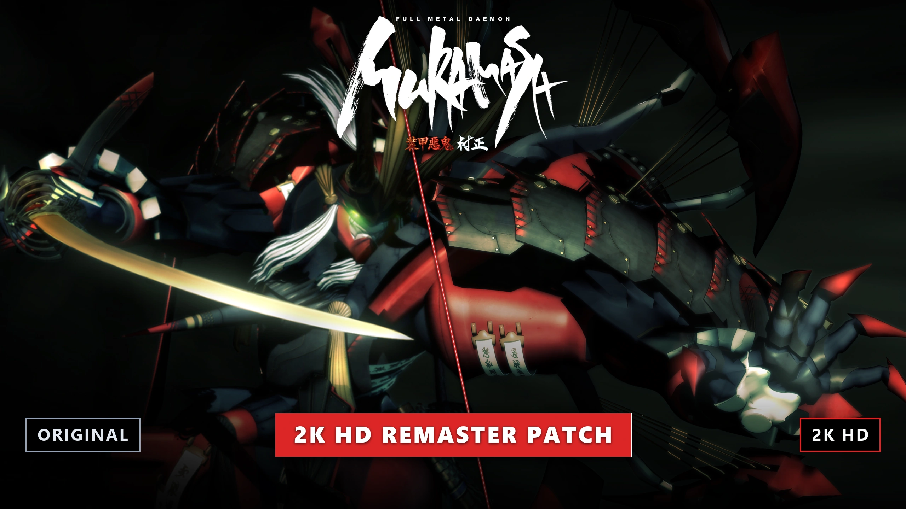
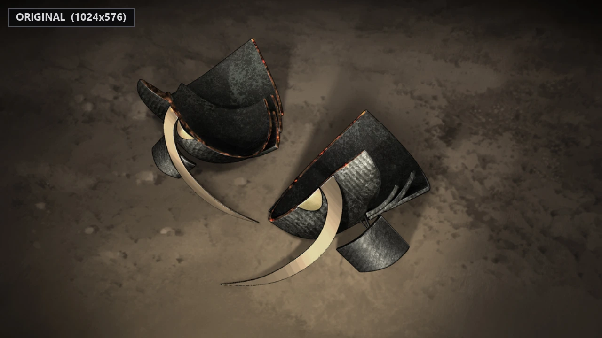
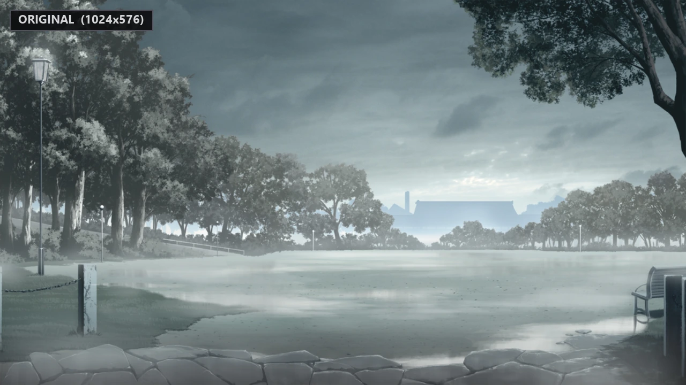
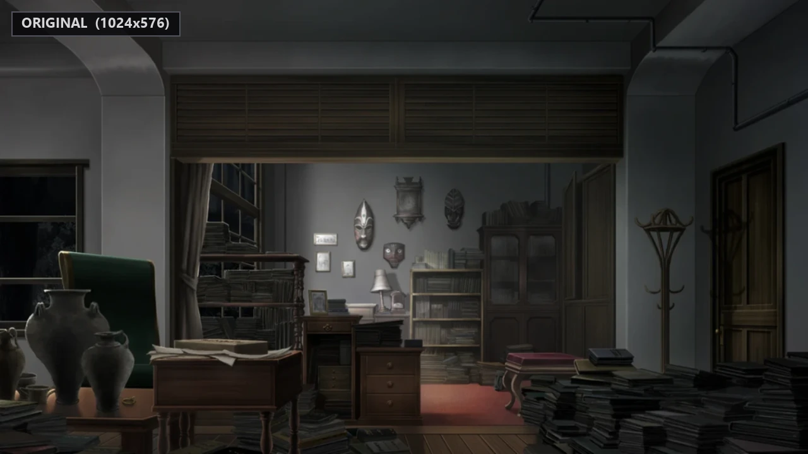
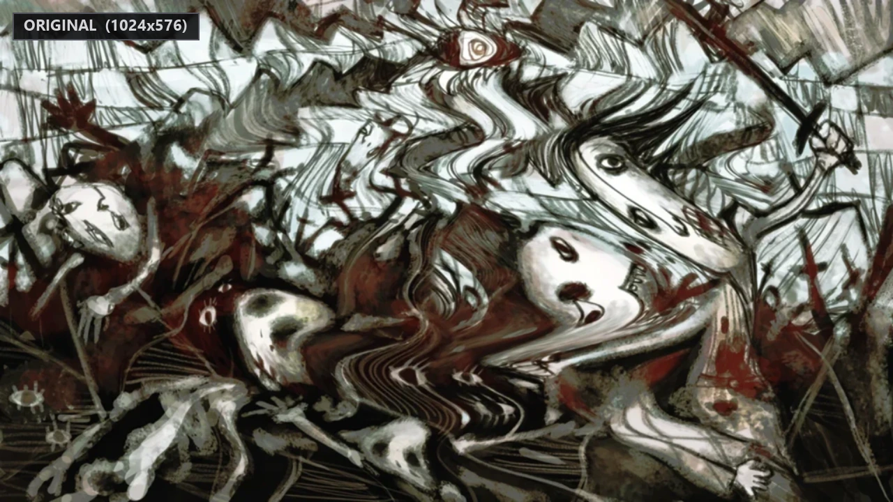
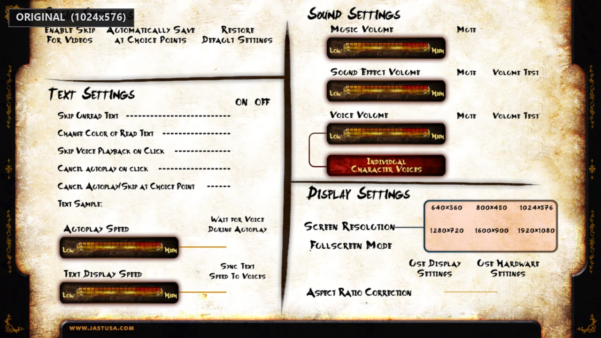
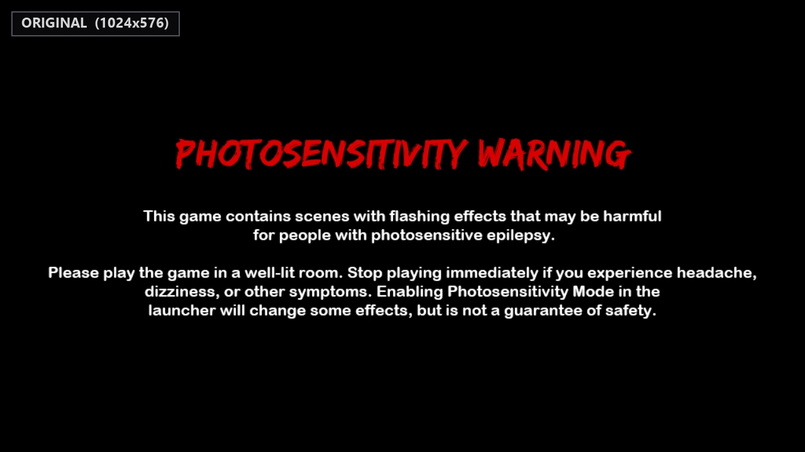

  

# Full Metal Daemon Muramasa: 2K HD Patch

Play **Full Metal Daemon Muramasa** (JAST USA English PC v1.04) in sharp 2560x1440 resolution. This patch replaces the original 1024x576 artwork, videos, and text with 2K HD versions and fixes memory crashes on modern Windows.
Model: 4x DAT2 + SD V1b34 Strong
## Before and After

  

> [!TIP]
> Click the red button above **or click any comparison image below** to open the [interactive 2K comparison page](https://ggouda.github.io/Full-Metal-Daemon-Muramasa-HD-Patch/showcase.html) with a draggable split slider, **2x / 3x zoom**, and the **live Opening Movie comparison**.

### Tsurugi Armor CG

### Overcast Park & Lake

### Professor's Study

### Event CG

### In-Game Menu

### HD Font & Text

## What You Get

- **2K Artwork**: 5,460 backgrounds, Event CGs, character sprites, effects, and menus in 2560x1440.
- **2K Cutscenes**: 78 in-game videos in 2K.
- **Sharp Text**: High-resolution dialogue fonts, title logo, and opening poem graphics.
- **Extra Launcher Options**: Pick 2560x1440 Borderless, toggle HD assets, or skip the intro from the standard game launcher.
- **Crash Fixes**: Expands memory limits to 4 GiB and keeps a backup of your original `muramasa_en.exe`.

## How to Install

1. Download **`Install_Muramasa_HD_Patch.exe`** from [Latest Releases](https://github.com/GGouda/Full-Metal-Daemon-Muramasa-HD-Patch/releases/latest) and run it.
2. Pick your Muramasa game folder (where `muramasa_en.exe` lives) and click **Install HD Patch**.

The installer downloads the 2K asset packs (~8.06 GiB), checks file integrity, and patches your game. Launch `muramasa_en.exe` to play.

### Updating or Uninstalling

- **Update**: Run a newer `Install_Muramasa_HD_Patch.exe` on the same game folder. It skips the 8 GiB asset packs you have and downloads the updated patch files.
- **Uninstall**: Open `Install_Muramasa_HD_Patch.exe`, select your game folder, and click **Uninstall Patch**. This restores your original `muramasa_en.exe` and removes the patch files.
