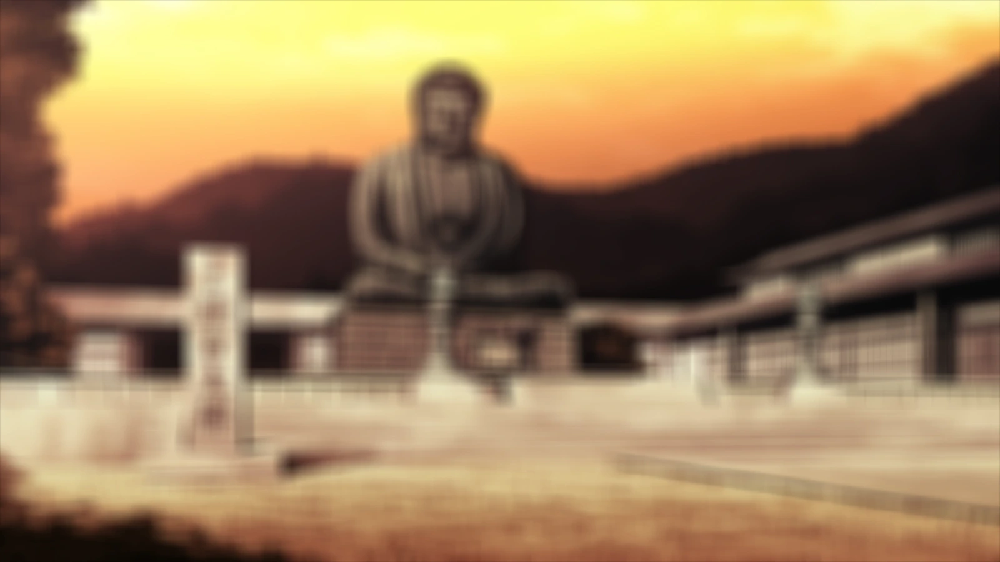
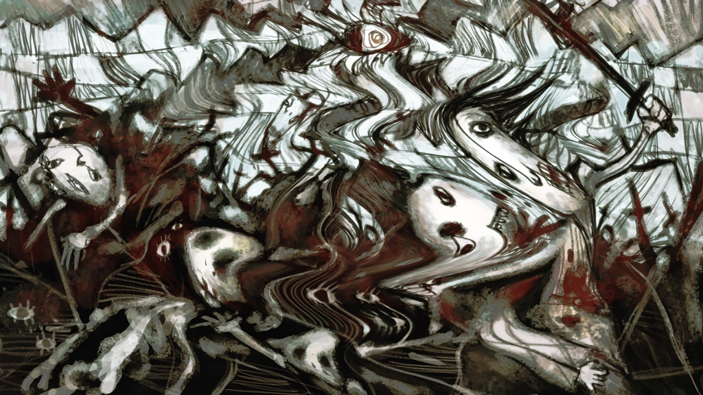

# Full Metal Daemon Muramasa — HD 2K Remaster Patch

Native **2560x1440** lossless visual overhaul, upscaled cutscenes, sharp GDI font rendering, launcher upgrades, and 4 GiB LAA memory stability for **Full Metal Daemon Muramasa** (JAST USA English PC v1.04).

---

## Interactive Before / After Comparison

> **[Open Interactive Comparison Slider](https://ggouda.github.io/Full-Metal-Daemon-Muramasa-HD-Patch/showcase.html)**
> Drag the split bar across backgrounds, interiors, and Event CGs directly in your browser.

| Stock Original (`1024x576`) | 2K Lossless HD (`2560x1440`) |
| :---: | :---: |
|  |  |
|  |  |

---

## Features

- **5,460 Lossless 2K Assets**: Backgrounds, Event CGs, character sprites, effects, and UI upscaled to native **2560x1440** (`lossless WebP`, zero lossy artifacts).
- **78 Upscaled Cutscenes**: All `.wmv` DX cutscenes upscaled to crisp 2K MP4 playback.
- **Crisp Typography & Re-Typeset Graphics**: High-res `2.5x` GDI glyph rendering, crisp title subtitle (`FULL METAL DAEMON`), and vector-rendered Lucida Calligraphy opening poem graphics.
- **4 GiB Memory Patch (`LAA`)**: Automatically enables `LARGE_ADDRESS_AWARE` on `muramasa_en.exe` (with automatic `muramasa_en_stock_backup.exe` backup) + cuts `CMovie` prebuffer RAM overhead to eliminate 32-bit OOM crashes.
- **Quality-of-Life Launcher**: Adds `2560x1440 (2K HD)` Borderless option, `Upscaled Assets` toggle, and `Skip Intro` option directly inside the stock game launcher.
- **Fixed UI Hitboxes**: Keeps invisible `*hit.png` hitmasks at logical coordinates so Config checkboxes toggle anywhere inside the box.

---

## Download & Installation (1-Click Auto-Installer)

1. Download **`Install_Muramasa_HD_Patch.exe`** (`~370 KB`) from [**Latest Releases**](https://github.com/GGouda/Full-Metal-Daemon-Muramasa-HD-Patch/releases/latest).
2. Run `Install_Muramasa_HD_Patch.exe`.
3. Click **Browse...** and select your base game folder (where `muramasa_en.exe` is located).
4. Click **Install HD Patch** — the installer automatically downloads the verified 2K asset packs (`~8.06 GiB` lossless) + latest patch from GitHub Releases, checks SHA-256 hashes, applies everything, and patches `muramasa_en.exe`.
5. Launch `muramasa_en.exe` as usual and enjoy!

### Updating Later

Re-run any newer `Install_Muramasa_HD_Patch.exe` on your game folder — it checks `.installed_packs.txt`, **skips all `8 GiB` unchanged asset packs**, and downloads only updated patch files in seconds.

### Uninstalling

Run `Install_Muramasa_HD_Patch.exe`, select your game folder, and click **Uninstall Patch** to remove `hd_assets/` + hooks and restore your original `muramasa_en.exe`.

---

## Asset Verification

- [Full Upscale Asset Dashboard](https://ggouda.github.io/Full-Metal-Daemon-Muramasa-HD-Patch/) (`78 / 78` videos & `5,460` images verified).
